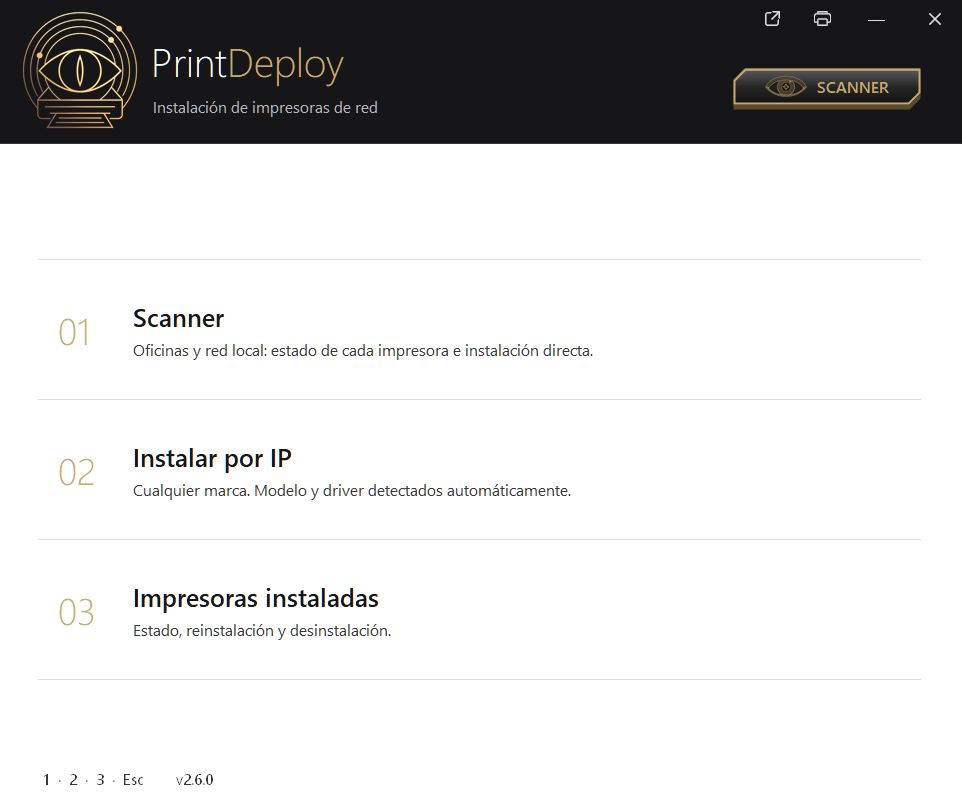
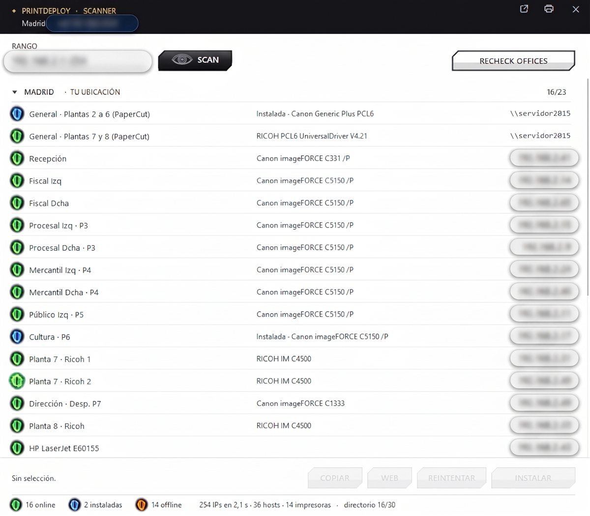

<!--
[ES] PrintDeploy: detecta marca y modelo de las impresoras de red e instala el driver adecuado más reciente; escáner, colas y servidor.
[EN] PrintDeploy: detects brand and model of network printers and installs the newest suitable driver; scanner, queues and server.
Contexto: admin
-->


<h1 align="center">PrintDeploy</h1>

<p align="center">
  Instala y repara impresoras de red en Windows con el driver correcto, sin preguntar el modelo.
</p>

<p align="center">
  
  
  
</p>

---

<p align="center">
  
  &nbsp;
  
</p>

## Qué hace

- **Escáner**: recorre la red local y el directorio de oficinas, identifica cada impresora por SNMP (Simple Network Management Protocol), IPP o web, y marca cuáles están online, offline o ya instaladas.
- **Instalar por IP**: detecta fabricante y modelo al escribir la IP y elige el driver más reciente entre el instalado en Windows y el que lleva el `.exe`.
- **Colas de servidor** (`\\servidor\cola`): conexión para el usuario y para todo el equipo, con credenciales del servidor si hacen falta y reintento con otros DNS si falla por resolución de nombres.
- **Impresoras instaladas**: estado de cada cola, reinstalación con el driver óptimo conservando su configuración, y desinstalación limpia (cola, puerto y driver huérfano).
- **Página de prueba** con confirmación en la propia impresora por SNMP (contador de páginas o aviso de sin papel, atasco...).
- **Portátil**: un único `.exe` elevado, con los drivers dentro; funciona desde USB o carpeta de red en Windows 10 y 11, x64 o ARM64. También se puede compilar con los drivers en una carpeta `Payload\` al lado ([docs/DEVELOPMENT.md](docs/DEVELOPMENT.md)).

## Compatibilidad

| | Estado |
|---|---|
| Ricoh IM C4500 · Canon imageFORCE C5150/P | Instaladas y en uso en el entorno de despliegue |
| Canon imageFORCE C331/P y C1333 · HP LaserJet E60155 | Detectadas en el entorno; instalación pendiente de validar |
| Ricoh IM C4510A | Driver propio en el código; sin prueba documentada |
| Resto de Ricoh / Canon | Driver universal (RICOH PCL6 UniversalDriver / Canon Generic Plus PCL6) |
| Otras marcas | Su driver universal si ya está instalado; si no, el genérico de Windows (sin bandejas ni acabados) |

Detalle, drivers y cómo añadir modelos: [docs/PRINTERS.md](docs/PRINTERS.md).

## Instalar y ejecutar

En PowerShell: descarga la última versión, la instala en el perfil del usuario con acceso en el menú Inicio y la abre (pide elevación). Repetirlo actualiza sin borrar un `oficinas.txt` que haya en esa carpeta.

```powershell
Set-ExecutionPolicy -Scope Process Bypass -Force; [Net.ServicePointManager]::SecurityProtocol=3072; $ProgressPreference='SilentlyContinue'; $d="$env:LOCALAPPDATA\Programs\PrintDeploy"; New-Item -ItemType Directory -Force $d | Out-Null; $f="$d\PrintDeploy.exe"; irm https://github.com/4leX-42/PrintDeploy/releases/latest/download/PrintDeploy.exe -OutFile $f; $s=(New-Object -ComObject WScript.Shell).CreateShortcut("$env:APPDATA\Microsoft\Windows\Start Menu\Programs\PrintDeploy.lnk"); $s.TargetPath=$f; $s.Save(); Start-Process $f
```

La release es un único `PrintDeploy.exe` con los drivers dentro. No lleva el directorio de oficinas: para verlas en el escáner, `oficinas.txt` ([formato](oficinas.example.txt)) junto al `.exe` o en `%ProgramData%\PrintDeploy\`. Compilar desde el código: [docs/DEVELOPMENT.md](docs/DEVELOPMENT.md).

Teclas: `1` escáner · `2` instalar por IP · `3` impresoras instaladas · `F5` reescanear · `Esc` volver.

## Documentación

| | |
|---|---|
| [Arquitectura](docs/ARCHITECTURE.md) | Componentes, flujo de instalación, motor y configuración |
| [Impresoras y drivers](docs/PRINTERS.md) | Modelos, elección de driver, añadir y validar modelos |
| [Desarrollo y pruebas](docs/DEVELOPMENT.md) | Compilar, payload, directorio, batería de pruebas |
| [Problemas frecuentes](docs/TROUBLESHOOTING.md) | Errores habituales, causa y solución |
| [CLAUDE.md](CLAUDE.md) | Reglas para asistentes de programación que modifiquen el proyecto |

Parte de [GADGETS-SUPPORT_CX](https://github.com/4leX-42/GADGETS-SUPPORT_CX), el catálogo de herramientas.
