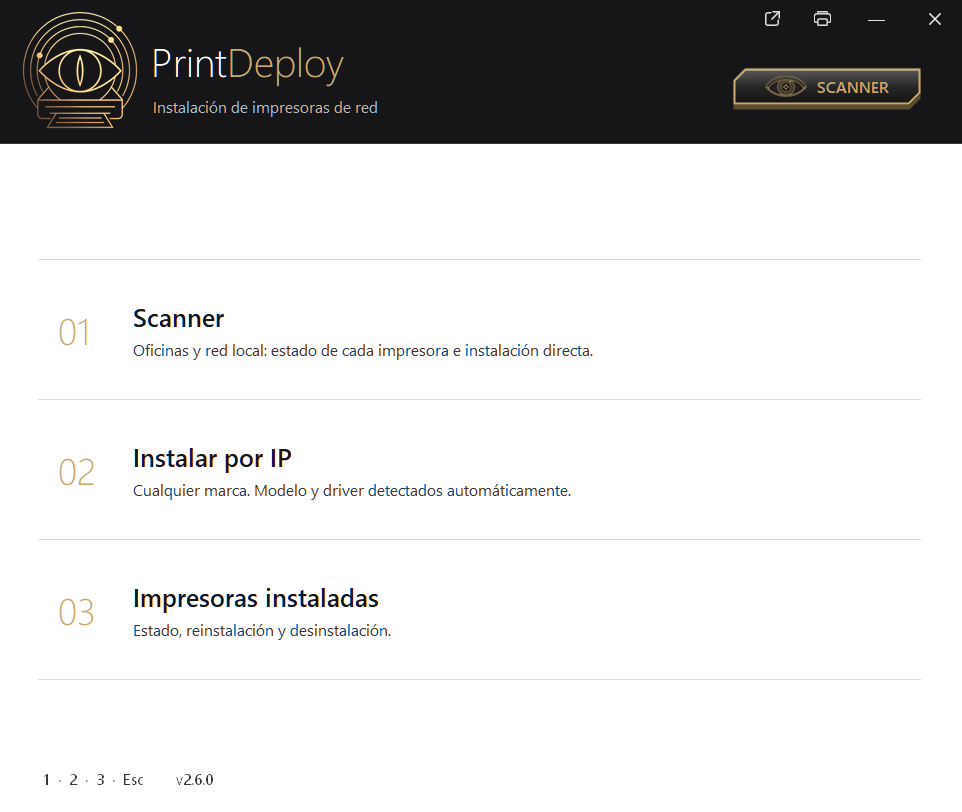
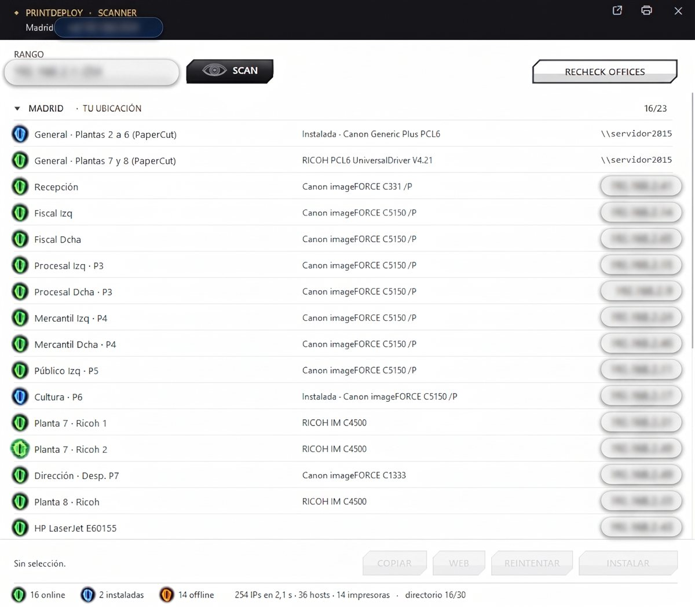

<!--
[ES] PrintDeploy: detecta marca y modelo de las impresoras de red e instala el driver adecuado más reciente; escáner, colas y servidor.
[EN] PrintDeploy: detects brand and model of network printers and installs the newest suitable driver; scanner, queues and server.
Contexto: admin
-->
<div align="center">

# PrintDeploy

Instalación y reparación de impresoras de red con el driver correcto, sin preguntar el modelo.

   

 

<sub>Parte de <a href="https://github.com/4leX-42/GADGETS-SUPPORT_CX">GADGETS-SUPPORT_CX</a></sub>

</div>

##  Instalar

```powershell
Set-ExecutionPolicy -Scope Process Bypass -Force; [Net.ServicePointManager]::SecurityProtocol=3072; $ProgressPreference='SilentlyContinue'; $d="$env:LOCALAPPDATA\Programs\PrintDeploy"; New-Item -ItemType Directory -Force $d | Out-Null; $f="$d\PrintDeploy.exe"; irm https://github.com/4leX-42/PrintDeploy/releases/latest/download/PrintDeploy.exe -OutFile $f; $s=(New-Object -ComObject WScript.Shell).CreateShortcut("$env:APPDATA\Microsoft\Windows\Start Menu\Programs\PrintDeploy.lnk"); $s.TargetPath=$f; $s.Save(); Start-Process $f
```

Un `.exe` elevado con los drivers dentro; portable desde USB o red. Repetir actualiza sin tocar `oficinas.txt` ([formato](oficinas.example.txt)).

##  Qué hace

| | |
|---|---|
|  **Escáner** | Red local y oficinas; identifica cada impresora por SNMP, IPP o web |
|  **Instalar por IP** | Detecta fabricante y modelo y elige el driver más reciente |
|  **Colas de servidor** | `\\servidor\cola` para usuario o equipo, con credenciales y reintento DNS |
|  **Instaladas** | Estado, reinstalación con driver óptimo y desinstalación limpia |
|  **Página de prueba** | Confirmada en la impresora por SNMP (contador, papel, atasco) |

`1` escáner · `2` instalar por IP · `3` instaladas · `F5` reescanear · `Esc` volver

##  Compatibilidad

| Modelos | Estado |
|---|---|
| Ricoh IM C4500 · Canon imageFORCE C5150/P | En uso |
| Canon imageFORCE C331/P, C1333 · HP LaserJet E60155 | Detectadas, instalación por validar |
| Ricoh IM C4510A | Driver propio, sin prueba |
| Resto de Ricoh / Canon | Driver universal PCL6 |
| Otras marcas | Su universal si está instalado; si no, genérico de Windows |

<details>
<summary> <b>Documentación</b></summary>

| | |
|---|---|
| [Arquitectura](docs/ARCHITECTURE.md) | Componentes, flujo de instalación, motor y configuración |
| [Impresoras y drivers](docs/PRINTERS.md) | Modelos, elección de driver, añadir y validar modelos |
| [Desarrollo y pruebas](docs/DEVELOPMENT.md) | Compilar, payload, directorio, batería de pruebas |
| [Problemas frecuentes](docs/TROUBLESHOOTING.md) | Errores habituales, causa y solución |
| [CLAUDE.md](CLAUDE.md) | Reglas para asistentes de programación |

Directorio de oficinas: `oficinas.txt` junto al `.exe` o en `%ProgramData%\PrintDeploy\` (no va en la release).
</details>
